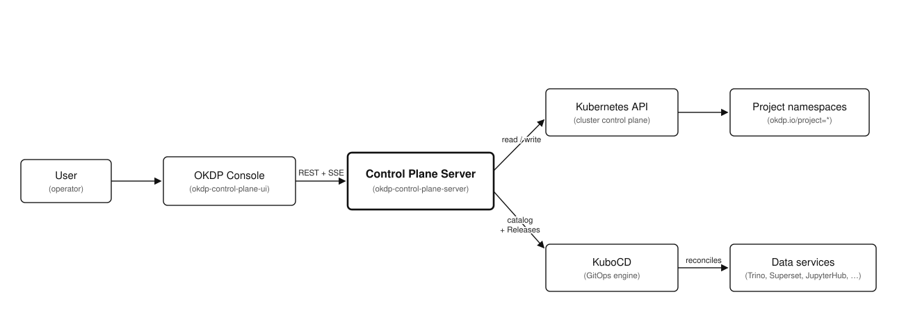

<p align="center">
  <a href="https://okdp.io">
    
  </a>
</p>

[](https://github.com/OKDP/okdp-control-plane-server/actions/workflows/release-please.yml)
[](http://www.apache.org/licenses/LICENSE-2.0)

# OKDP Control Plane Server

Docker image and Helm chart for the backend API of the OKDP web console
([okdp-control-plane-ui](https://github.com/OKDP/okdp-control-plane-ui)): a Go service that
manages OKDP projects and their data services on Kubernetes and exposes them to the console
over REST and Server-Sent Events (SSE).

---

## Why this project

The OKDP web console is a browser single-page application with no cluster credentials and
no server-side logic, so it cannot drive Kubernetes on its own. This repository is its
backend: an API that turns console actions into cluster operations, creating project
namespaces, deploying and updating data services, serving the service catalog, and
streaming their status, pods and metrics.

It is a first-party OKDP component, developed alongside the web console. Cluster credentials
and business logic stay on the server side, keeping the console a stateless browser client.

---

## What the project does

- **Docker image** `quay.io/okdp/images/okdp-control-plane-server`: runs the Go control-plane API
  server on a minimal Alpine base, listening on port `8093`.
- **Helm chart** (`chart/`): deploys the server in-cluster with the RBAC it needs to
  reach the Kubernetes API and KuboCD.

The image and chart provide the backend for the OKDP web console, so the platform is
driven through the console instead of raw `kubectl` and KuboCD manifests.

Project layout:

- `cmd/server`: entry point and persistence mode wiring (`kubernetes` or `git`).
- `internal/api`: HTTP handlers, SSE endpoints, and router.
- `internal/auth`: OIDC bearer token verification and caller identity propagation.
- `internal/service`: business logic and contract validation.
- `internal/engine`: the ports between the server and its deployment engine
  (desired state, observation, catalog, platform settings), the Kubernetes KuboCD
  adapter (`internal/engine/kubocd`), the GitOps KuboCD adapter
  (`internal/engine/kubocdgit`), and an in-memory fake engine used in tests.
- `internal/gitstore`: pure-Go Git repository store (no `git` binary required).
- `internal/gitops`: sync-tool abstraction (`SyncAdapter`) and its Flux implementation
  (`internal/gitops/flux`).
- `internal/repository`: data access (Kubernetes and KuboCD clients).
- `internal/models`: API request and response models.
- `internal/config`: configuration loaded from environment variables.
- `chart/`: Helm chart.

---

## Architecture

<p align="center">
  
</p>

> **OKDP deployment context:** the server runs **in-cluster**. It reads shared platform
> settings (ingress, OIDC, identity, Spark, Jupyter profiles) from a read-only platform
> KuboCD `Context` and manages the editable service catalog in a separate Control Plane
> `Context`. In `kubernetes` persistence mode it writes projects, KuboCD `Release`s,
> `Connection`s, `SecretStore`s, and `ExternalSecret`s directly to the cluster. In `git`
> persistence mode it commits those manifests to a Git branch and watches Flux apply them,
> while keeping credentials `Secret`s and cluster-wide `ClusterConnection`s in Kubernetes.
> Projects are modeled as plain namespaces, so no extra CRD or operator is introduced.
> TLS is terminated at the platform ingress, while the server validates OIDC bearer tokens
> directly against the platform issuer (unless `AUTH_DISABLED=true`).

See the [KuboCD documentation](https://github.com/kubotal/kubocd) for the `Context`
and `Release` model the server builds on.

---

## Requirements

- Kubernetes cluster with [KuboCD](https://github.com/kubotal/kubocd) installed (provides the `Context` and `Release` CRDs the server reads and writes)
- A **kubeconfig** with permission to manage namespaces and to read/write KuboCD `Context` and `Release` resources (in-cluster, the chart wires the ServiceAccount RBAC)
- [Go](https://go.dev/) >= 1.25 (only to build the image or run the server locally)

Known-good baseline: chart and image `0.10.0` <!-- x-release-please-version -->
with Go `1.25`, on a Kind cluster. This is the version set validated by the maintainers.

### Toolchain tested

| Tool | Version |
|---|---|
| Go | `1.25` |
| Kind | `0.27.0` |
| kubectl | `1.32.2` |

> The server does not need the `helm` or `kubectl` binaries to run: it communicates with the
> Kubernetes API through the client-go library. Helm (>= 3) is needed only to deploy the
> chart, and `kubectl` to inspect the cluster.

---

## Installation

The server runs in-cluster and needs a Kubernetes cluster with [KuboCD](https://github.com/kubotal/kubocd) installed (the `Context` and `Release` CRDs must exist):

```sh
kubectl get crd | grep kubocd
# configs.kubocd.kubotal.io
# contexts.kubocd.kubotal.io
# releases.kubocd.kubotal.io
```

The `Release` objects the server creates carry no explicit `spec.contexts`: they
take the platform configuration from the Contexts the KuboCD `Config` declares,
through `defaultContexts` and `defaultNamespaceContexts`. A cluster whose Config
declares neither renders its packages against an empty configuration, so the
platform `Context` this server reads must also be listed there. For example:

```yaml
apiVersion: kubocd.kubotal.io/v1alpha1
kind: Config
spec:
  defaultContexts:
    - name: platform
      namespace: okdp-system
```

Install the chart from the OKDP registry:

<!-- x-release-please-start-version -->
```sh
helm install okdp-control-plane-server oci://quay.io/okdp/charts/okdp-control-plane-server --version 0.10.0 \
  -n okdp-system --create-namespace
```
<!-- x-release-please-end -->

> This chart name is published on Quay once the rename lands upstream. Until
> then, install from `chart/` in this checkout.

Once the pod is `Running`, reach the API through a port-forward:

```sh
kubectl port-forward -n okdp-system svc/okdp-control-plane-server 8093:8093
curl -s http://localhost:8093/health
# {"status":"ok"}
```

The Swagger UI is then available at `http://localhost:8093/swagger/index.html`.

---

## Cleanup

Remove the Helm release, and the namespace if it was created only for this install:

```sh
helm uninstall okdp-control-plane-server -n okdp-system
kubectl delete namespace okdp-system
```

---

## Development

### Run the server locally

Both options require a `KUBECONFIG` pointing at a Kubernetes cluster with KuboCD
installed: the server connects to the Kubernetes API at startup.

**On your machine.** Install Go and the development tools (`kubectl`, `kubocd`, `air`,
`swag`, `golangci-lint`, `delve`), then:

```sh
export KUBECONFIG=<path-to-your-kubeconfig>
make dev                 # hot-reload on :8093
# or, without hot-reload:
go run ./cmd/server
```

**In the devcontainer.** Only Docker is required: open the repository and select "Reopen
in Container" (or run `devcontainer up`). The container ships the full toolchain,
publishes port 8093 and syncs a container-reachable copy of the host kubeconfig at
startup. Then run `make dev`.

### Build, test and lint

No cluster is required:

```sh
make build     # compile the binary to bin/server
make test      # run the tests
make lint      # run golangci-lint
make swagger   # regenerate the Swagger documentation
```

Run `make help` for the full list of targets.

---

## Configuration

The server is configured through environment variables, rendered by the chart from
its `configuration:` and `engine:` values (see [`chart/values.yaml`](chart/values.yaml)).

| Parameter | Description | Default | Required |
|-----------|-------------|---------|:--------:|
| `PORT` | HTTP port the server listens on | `8093` | No |
| `PLATFORM_NAMESPACE` | Namespace where the OKDP platform runs | `okdp-system` | No |
| `ALLOWED_ORIGINS` | Single CORS origin, set verbatim in `Access-Control-Allow-Origin` (the console URL) | `http://localhost:4200` | No |
| `LOG_LEVEL` | Log verbosity (`debug`, `info`, `warn`, `error`) | `info` | No |
| `KUBOCD_NAMESPACE` | Namespace where KuboCD runs | `kubocd-system` | No |
| `CONTROL_PLANE_CONTEXT_NAME` | Name of the Control Plane `Context`, holding the service catalog the console edits. Created from the platform catalog on the first edit when missing (kubernetes mode), committed at startup (git mode). Must differ from `PLATFORM_CONTEXT_NAME` (or its namespace) in git mode | `control-plane` | No |
| `CONTROL_PLANE_CONTEXT_NAMESPACE` | Namespace of the Control Plane `Context` (falls back to legacy `CONTEXT_NAMESPACE` if set) | the server's own namespace | No |
| `PLATFORM_CONTEXT_NAME` | Name of the platform `Context` (ingress, OIDC, identity, profile images, Spark), read only. Falls back to legacy `CONTEXT_NAME` during upgrades when unset. When it differs from `CONTROL_PLANE_CONTEXT_NAME`, the catalog falls back to this one while the Control Plane `Context` is missing or has no `serviceCatalog` | `platform` | No |
| `PLATFORM_CONTEXT_NAMESPACE` | Namespace of the platform `Context` (falls back to legacy `CONTEXT_NAMESPACE` if set) | `CONTROL_PLANE_CONTEXT_NAMESPACE` | No |
| `RELEASE_INTERVAL` | Reconcile interval set on created KuboCD `Release`s (read by the `kubocd` engine). Written in the canonical form KuboCD stores (`30m` becomes `30m0s`), a value that is not a duration stops the server | `30m` | No |
| `RELEASE_TIMEOUT` | Timeout set on created KuboCD `Release`s (read by the `kubocd` engine), same rules | `10m` | No |
| `ENGINE_TYPE` | Deployment engine. Only `kubocd` is supported | `kubocd` | No |
| `ENGINE_KUBOCD_BACKEND` | What the KuboCD controller produces from a `Release`. Only `flux` is supported | `flux` | No |
| `ENGINE_KUBOCD_PERSISTENCE_MODE` | Where the desired state is stored. `kubernetes` writes projects, `Release`s, `Connection`s, `SecretStore`s and `ExternalSecret`s to the cluster. `git` commits them, a sync tool applies the branch | `kubernetes` | No |
| `ENGINE_KUBOCD_PERSISTENCE_GIT_URL` | Repository the server commits to | empty | In git mode |
| `ENGINE_KUBOCD_PERSISTENCE_GIT_BRANCH`, `_PATH` | Branch, and directory the server owns (empty: the root) | `main`, empty | No |
| `ENGINE_KUBOCD_PERSISTENCE_GIT_SYNC` | `flux`: the server validates the Flux objects at startup, wakes them after each commit and reports what they applied. `none`: something else applies the branch | `flux` | No |
| `ENGINE_KUBOCD_PERSISTENCE_GIT_INITIALIZE` | Create the branch layout and the Control Plane `Context` file at startup when missing | `true` | No |
| `ENGINE_KUBOCD_PERSISTENCE_GIT_CREDENTIALS_DIR` | Git Secret mounted as files, in the Flux `GitRepository` layout (`username`/`password`, `bearerToken`, `ca.crt`, SSH `identity` + `known_hosts`). Read on every fetch and push, so a rotated Secret applies without a restart. Missing: anonymous access | `/etc/okdp/git` | No |
| `ENGINE_KUBOCD_PERSISTENCE_GIT_COMMITTER_NAME`, `_EMAIL` | Git committer identity written on commits created by the server (author comes from the caller's OIDC identity) | `OKDP Control Plane`, `control-plane@okdp.io` | No |
| `ENGINE_KUBOCD_PERSISTENCE_GIT_SYNC_NAMESPACE` | Namespace of the Flux objects | `PLATFORM_NAMESPACE` (chart: the release namespace) | No |
| `ENGINE_KUBOCD_PERSISTENCE_GIT_REPOSITORY_NAME`, `_KUSTOMIZATION_NAME` | Flux `GitRepository` and `Kustomization` the server watches | empty (chart: the release fullname) | With sync `flux` |
| `ENGINE_KUBOCD_PERSISTENCE_GIT_SYNC_CLEANUP_NAME` | In kubernetes mode, the server deletes at startup the `Kustomization`, then the `GitRepository`, of that name in the sync namespace when they carry `app.kubernetes.io/managed-by-control-plane: <name>`. What they applied stays (`deletionPolicy: Orphan`, required) | empty (chart: the release fullname) | No |
| `EXCLUDED_SIDECAR_PREFIXES` | Container name prefixes excluded from pod/metrics views (comma-separated) | `istio-proxy,istio-init,dynatrace-,linkerd-proxy,envoy,vault-agent` | No |

The server reads `ENGINE_TYPE` and the selected engine validates its own section at
startup: an unsupported value stops the server with a message naming the field and its
variable. Without any `ENGINE_*` variable the server behaves as `kubocd` with the `flux`
backend and `kubernetes` persistence. In the chart:

```yaml
engine:
  type: kubocd
  kubocd:
    backend: flux
    persistence:
      mode: kubernetes
```

### Git mode

```yaml
engine:
  kubocd:
    persistence:
      mode: git
      git:
        url: https://forge.example/okdp/deployments.git
        path: clusters/prod
        secretName: okdp-git      # Flux GitRepository layout, in the release namespace
```

The chart then renders, in the release namespace and named after the release, a Flux
`GitRepository` and a `Kustomization` (`prune: true`, `wait: false`,
`deletionPolicy: Orphan`) impersonating a `<fullname>-gitops` ServiceAccount limited to
namespaces, `Context`s, `Connection`s, `Release`s, `SecretStore`s and `ExternalSecret`s.
The server's own ClusterRole loses its writes on those kinds, plus `delete` on `pods`,
`persistentvolumeclaims`, and `kubauth.kubotal.io/oidcclients` (it reads them and keeps
the credentials `Secret`s and `ClusterConnection`s). With `sync: none`, the chart also
omits the `<fullname>-gitops-sync` `Role` and `RoleBinding`. With `sync: none` or
`createSyncResources: false` the chart renders no Flux object. With the latter, bring a
`GitRepository` and a `Kustomization` named after the release, with `prune: true`, empty
`targetNamespace`, no `kubeConfig`, and a `serviceAccountName` (the server refuses to
start otherwise).

| Value | Effect |
|---|---|
| `keepSyncOnUninstall: true` (default) | `helm uninstall` leaves the five sync objects (`GitRepository`, `Kustomization`, plus the `<fullname>-gitops` `ServiceAccount`, `ClusterRole`, and `ClusterRoleBinding`): `git push` keeps driving the platform |
| upgrade back to `mode: kubernetes` | the server deletes the `Kustomization` and `GitRepository` at startup while leaving projects, services and volumes in place. It refuses to start while the `Kustomization` is not `deletionPolicy: Orphan`, cannot be read or deleted, or is not gone after 30s. The `<fullname>-gitops` `ServiceAccount`, `ClusterRole`, and `ClusterRoleBinding` stay in the cluster because the server has no RBAC permission to delete RBAC objects: remove them manually after switching back, or before a fresh `helm install` in git mode under the same release name |

**Git to Flux trust boundary.** Anyone who can push to the configured branch and path can
cause Flux (impersonating `<fullname>-gitops`) to create, modify, or delete namespaces,
`Context`s, `Connection`s, `Release`s, `SecretStore`s, and `ExternalSecret`s across the
cluster. Protect the branch against force pushes and unauthorized direct writes, keep
repository credentials in a Secret rather than in the URL, and never commit workload
credentials to Git.

**Service deletion cleanup in git mode.** Because the server drops `delete` permissions on
`pods`, `persistentvolumeclaims`, and `kubauth.kubotal.io/oidcclients` in git mode,
deleting a service commits the `Release` removal and answers `202` with
`{"operation": {...}}` without synchronously deleting Kubauth `OIDCClient` resources or
user-spawned pods and PVCs (such as JupyterHub user volumes). Those resources are reclaimed
when the underlying package or project namespace is removed, or must be cleaned up out of
band.

In git mode, a write whose push cannot be settled answers `504` (it may still land, read
the object again), a missing project namespace not yet applied by Flux answers `503` (retry
once synced), and a push refused by the Git remote answers `502`.

> For the full chart values (image, service, resources, security contexts, RBAC), see
> [`chart/values.yaml`](chart/values.yaml).

---

## Images

Images are published to [`quay.io/okdp`](https://quay.io/organization/okdp).

| Image | Tag format | Example |
|-------|-----------|---------|
<!-- x-release-please-start-version -->
| `quay.io/okdp/images/okdp-control-plane-server` | `<version>` (matches the chart `appVersion`) | `quay.io/okdp/images/okdp-control-plane-server:0.10.0` |
<!-- x-release-please-end -->

> See the [available tags on quay.io](https://quay.io/repository/okdp/images/okdp-control-plane-server?tab=tags) for all published versions.

---

## Troubleshooting

### The pod restarts in a loop (`CrashLoopBackOff`)

**Cause:** the server builds its Kubernetes client at startup and exits if it cannot.
The logs show `Failed to initialize Kubernetes client: failed to get kubernetes config
(tried in-cluster and local)`. In-cluster this means the ServiceAccount or its RBAC is
missing. For a local run it means `KUBECONFIG` is unset or invalid.

**Fix:** in-cluster, make sure the chart's ServiceAccount and RBAC are applied. Locally,
point `KUBECONFIG` at a valid config. Then check the logs and permissions:

```sh
kubectl logs -n okdp-system -l app.kubernetes.io/name=okdp-control-plane-server
kubectl auth can-i list namespaces
```

### The server stops at startup in git mode

**Cause:** with sync `flux` the server checks that its `GitRepository` and
`Kustomization` exist and pull the URL, branch and path it commits to. It waits 15s for
objects that do not exist yet and stops at once on objects that point elsewhere, with
a message naming each mismatch.

**Fix:** align `engine.kubocd.persistence.git` with the Flux objects, or let the chart
render them (`createSyncResources: true`):

```sh
kubectl get gitrepository,kustomization -n okdp-system
```

### API calls fail only in the browser (CORS)

**Cause:** the server returns `Access-Control-Allow-Origin` set verbatim to
`ALLOWED_ORIGINS` (default `http://localhost:4200`). When that value does not match the
origin the console is served from, the browser blocks the response and its console shows
`No 'Access-Control-Allow-Origin' header`. The same requests still work with `curl`.

**Fix:** set `ALLOWED_ORIGINS` to the exact console origin and redeploy.

### The service catalog is empty, or `GET /api/platform-services` returns `500`

**Cause:** the catalog is read from the Control Plane `Context` (`CONTROL_PLANE_CONTEXT_NAME`
in `CONTROL_PLANE_CONTEXT_NAMESPACE`), and from the platform one (`PLATFORM_CONTEXT_NAME`)
while the Control Plane `Context` is missing or has no `serviceCatalog`. In git mode it is
read from `contexts/<CONTROL_PLANE_CONTEXT_NAME>.yaml` in the repository. A `500` means none
of them can be read or KuboCD is not installed. An empty but successful catalog means the
`Context` exists yet has no `serviceCatalog`.

**Fix:** confirm KuboCD is installed and the `Context`s exist:

```sh
kubectl get crd | grep kubocd
kubectl get context -n okdp-system
```

---

## Contributing & License

Contributions follow the [OKDP contribution guide](https://github.com/OKDP/.github/blob/main/CONTRIBUTING.md). Released under the [Apache License 2.0](LICENSE).

---

**Built 🚀 for the OKDP Community**
<a href="https://okdp.io">
  
</a>
